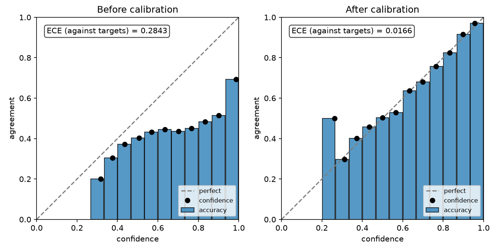
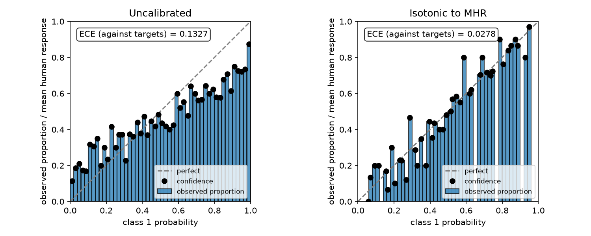

# Reliability diagrams

Install the optional plotting dependency:

```bash
pip install "fiducio[plots]"
```

`import fiducio` does not load matplotlib. The plotting helper imports it only
when called.

## Read a diagram

Each black dot compares a bin's **mean predicted confidence** (horizontal axis)
with its **observed agreement** (vertical axis):

- On the dashed diagonal: confidence matches agreement in that bin.
- Below it: over-confidence. Above it: under-confidence.
- Bars show the same agreement at the bin centers; empty bins are omitted.

By default, confidence is the largest class probability and agreement is the
fraction of correct predictions. With soft targets, agreement is the target
proportion assigned to the predicted class. A diagram describes the evaluated
population; it does not guarantee calibration on new data or within subgroups.

## Before and after temperature scaling



This figure uses separate cases for fitting and evaluation. It is a synthetic
example, not a result from the paper. Run
[`examples/reliability_diagram.py`](https://github.com/fiducio-ai/Fiducio/blob/main/examples/reliability_diagram.py)
from the repository to reproduce it as `outputs/reliability.png`.

The same workflow in a standalone snippet:

```python
import matplotlib.pyplot as plt
import torch
from fiducio import TemperatureScaling
from fiducio.plots import reliability_diagram

torch.manual_seed(0)
signal = torch.randn(16, 4, 32, 32)
labels = signal.argmax(dim=1)
logits = (signal + torch.randn_like(signal)) * 4

cal = TemperatureScaling(device="cpu").fit(logits[:8], labels[:8])
test_logits, test_labels = logits[8:], labels[8:]

fig, axes = plt.subplots(1, 2, figsize=(9, 4.5))
reliability_diagram(test_logits.softmax(1), test_labels, ax=axes[0], title="Before calibration")
reliability_diagram(cal.transform(test_logits), test_labels, ax=axes[1], title="After calibration")
fig.tight_layout()
fig.savefig("reliability.png", dpi=150)
plt.close(fig)
```

The helper takes **probabilities**, even when the calibrator was fitted on
logits. It returns a matplotlib `Axes` and accepts `mask` and `ignore_index`
like the metrics.

## Class reliability against annotator proportions



With `class_index=1`, the horizontal axis is the probability of class 1 and the
vertical axis is its observed frequency or mean annotator proportion. The
figure uses 50 evaluation bins and compares uncalibrated probabilities with a
binary isotonic map fitted to MHR on separate cases. Isotonic calibration may
change the segmentation at threshold 0.5.

Given separate calibration and test arrays (`p_fit`, `votes_fit`, `p_test`,
`votes_test`), plot the test cases as follows. Probabilities have shape
`(B, 2, *spatial)` and votes have shape `(B, R, *spatial)`:

```python
import matplotlib.pyplot as plt
from fiducio import BinaryIsotonicCalibration, mean_human_response
from fiducio.plots import reliability_diagram

q_fit, valid_fit = mean_human_response(votes_fit, num_classes=2)
q_test, valid_test = mean_human_response(votes_test, num_classes=2)
cal = BinaryIsotonicCalibration(input_type="probs", device="cpu")
cal.fit(p_fit, q_fit, mask=valid_fit)

fig, axes = plt.subplots(1, 2, figsize=(10, 4))
reliability_diagram(
    p_test, q_test, mask=valid_test, class_index=1, n_bins=50, ax=axes[0], title="Uncalibrated"
)
reliability_diagram(
    cal.transform(p_test, mask=valid_test),
    q_test,
    mask=valid_test,
    class_index=1,
    n_bins=50,
    ax=axes[1],
    title="Isotonic to MHR",
)
fig.tight_layout()
fig.savefig("reliability_mhr.png", dpi=150)
plt.close(fig)
```

Missing votes use `-100`; the helper excludes them from each voxel's denominator.
Always pass its mask when evaluating MHR, since voxels with no votes have zero
target mass. The annotation is **ECE against MHR**, not mean per-rater ECE.
See the [multi-rater guide](multi_rater.md#metrics-two-different-eces) for the
distinction and
[`examples/multi_rater_calibration.py`](https://github.com/fiducio-ai/Fiducio/blob/main/examples/multi_rater_calibration.py)
for a complete runnable example. That script reproduces the figure as
`outputs/multi_rater_reliability.png`.

## Change the summary or build a custom plot

Both figures annotate ECE: each bin's gap is weighted by its voxel count.
Use `metric="ace"` for the unweighted mean over nonempty bins, or `metric=None`
to hide the annotation. This ACE is not adaptive/equal-mass binning.
`n_bins` controls uniform evaluation bins, separately from the isotonic
calibrator's approximately equal-mass fitting bins.

For custom plots, [`reliability_curve`](api/metrics.md) returns `bin_edges`,
`bin_confidence`, `bin_accuracy`, `bin_counts`, `ece` and `ace`. Inspect
`bin_counts` before interpreting a noisy or sparsely populated bin.
